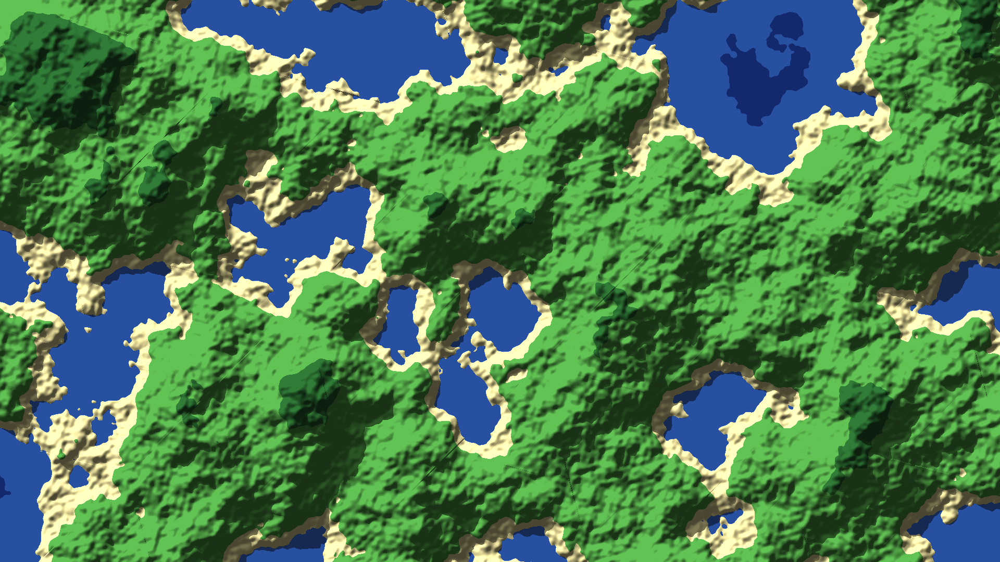

Fantasy Map Generator in Rust!

Replacement for the original written in Python.

Here's an image for cool stuff! 

Learning the language so please excuse any negligence of custom/best practices.

It's an itty-bitty project so everything in it should be fairly straight forward. Any sources I both find useful and felt compelled to cite are located in ~./src/source.txt
